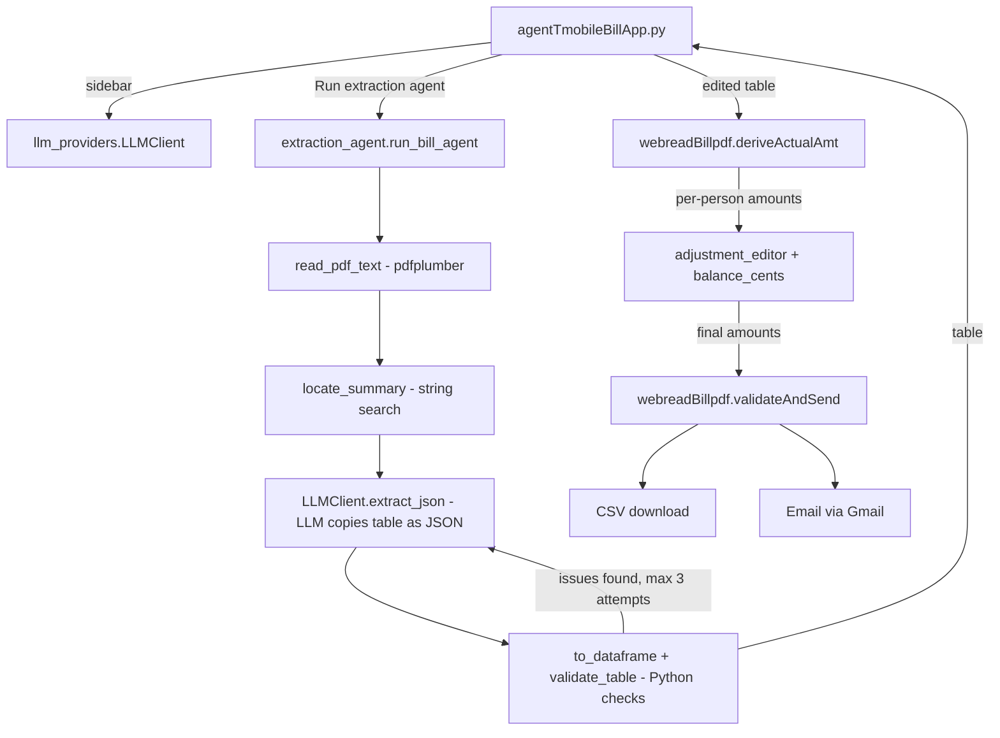

# Agent T-Mobile Bill Analyzer

A Streamlit web app that splits a T-Mobile bill per person. An LLM agent reads the
**"THIS BILL SUMMARY"** table from the bill PDF (no regex parsing), Python checks the
numbers, and the existing per-line math from `webreadBillpdf.py` does the split.
The CSV download and email work the same way as in the original app.

```bash
streamlit run agentTmobileBillApp.py
```

---

## Project structure

```
agentTmobileBillApp/
├── agentTmobileBillApp.py            # Streamlit app (entry point / "Main file path" on Streamlit Cloud)
├── tmobile_bill_agent/               # Agent package used by the app
│   ├── __init__.py
│   ├── llm_providers.py              # LLM connection: Groq / Ollama / Gemini / OpenRouter / Anthropic
│   └── extraction_agent.py           # Agent loop: read PDF -> LLM extract -> validate -> retry
├── webreadBillpdf.py                 # Original app; reused unchanged for math, CSV and email
├── requirements.txt                  # Python dependencies (installed by Streamlit Cloud)
├── config.example.json               # Template for config.json (email recipient lists)
├── .streamlit/
│   └── secrets.toml.example          # Template for secrets.toml (API keys + email lists)
├── .gitignore                        # Keeps secrets, config.json, PDFs and CSVs out of git
└── README.md

Not committed (local only, ignored by .gitignore):
├── .streamlit/secrets.toml           # Your real API keys
└── config.json                       # Your real email recipient lists
```

| File | Role |
|---|---|
| `agentTmobileBillApp.py` | Builds the UI: sidebar LLM settings, PDF upload, editable tables, cents adjustment, CSV/email section. If `config.json` is missing (as on Streamlit Cloud), it creates it from secrets. |
| `tmobile_bill_agent/llm_providers.py` | `LLMClient` gives every provider the same `extract_json(...)` call. `PROVIDERS` lists the providers; Groq is the default. |
| `tmobile_bill_agent/extraction_agent.py` | `run_bill_agent(...)` reads the PDF, locates the summary table, asks the LLM to copy it, validates it and retries with feedback. It also contains `balance_cents(...)` for auto-balancing. |
| `webreadBillpdf.py` | Provides `deriveActualAmt()` (per-line/per-person math) and `validateAndSend()` (CSV + email). Not modified. |
| `config.json` | Read by `webreadBillpdf.load_email_list()` when sending email. |
| `.streamlit/secrets.toml` | Read by Streamlit as `st.secrets`; the sidebar fills in the API key from here. |

---

## How the files are invoked



Step by step:

1. **Sidebar:** `llm_sidebar()` builds an `LLMClient` from the chosen provider, model and API key.
2. **Run extraction agent:** `run_agent()` calls `run_bill_agent(pdf, llm)`, which:
   - reads the page text with pdfplumber (`read_pdf_text`);
   - cuts out the text between `THIS BILL SUMMARY` and `DETAILED CHARGES` (`locate_summary`);
   - asks the LLM to copy the column headers and each row's amounts in printed order (`LLMClient.extract_json`);
   - lines the amounts up with the columns and converts them to numbers (`to_dataframe`);
   - checks the table (`validate_table`). If anything fails, the exact errors go back to the LLM and it tries again, up to the "Max agent attempts" setting.
3. **Per-line math:** the checked table goes through `to_derive_frame()` and then into `deriveActualAmt()`, the same function the original app uses.
4. **Adjustment:** `adjustment_editor()` shows each person's amount with an editable **Final amount** column; `balance_cents()` powers **Auto-balance cents**.
5. **Output:** the final amounts go to `validateAndSend()`, the same function the original app uses for the CSV download and email.

---

## Run locally

```bash
cd agentTmobileBillApp
pip install -r requirements.txt
cp .streamlit/secrets.toml.example .streamlit/secrets.toml   # then paste your real GROQ_API_KEY
cp config.example.json config.json                           # then add real email addresses
streamlit run agentTmobileBillApp.py
```

Get a free Groq API key at https://console.groq.com/keys.

**Ollama (local, no key):** only works when you run the app on your own machine, not on Streamlit Cloud.

---

## Deploy to Streamlit Community Cloud

> ⚠️ **Keep the GitHub repo private.** `webreadBillpdf.py` contains the family's phone
> numbers and names (in the phone-to-name mapping used by the per-line math).

1. **Push to GitHub** (private repo):
   ```bash
   cd agentTmobileBillApp
   git init && git add . && git status     # confirm secrets.toml, config.json and *.pdf are NOT listed
   git commit -m "Agent T-Mobile bill analyzer"
   git branch -M main
   git remote add origin https://github.com/<your-user>/agentTmobileBillApp.git
   git push -u origin main
   ```
2. Go to https://share.streamlit.io, sign in with GitHub, and click **Create app**:
   - **Repository:** `<your-user>/agentTmobileBillApp`
   - **Branch:** `main`
   - **Main file path:** `agentTmobileBillApp.py`
   - **Advanced settings → Python version:** 3.12
3. **Advanced settings → Secrets:** paste the contents of your local `.streamlit/secrets.toml`, using
   `.streamlit/secrets.toml.example` as the template. Include the real `GROQ_API_KEY`,
   `to_address_list` and `main_address_list`.
4. Click **Deploy**. Streamlit Cloud installs `requirements.txt` and starts the app.
5. **Restrict who can open it:** go to App → **Settings → Sharing** and allow only invited
   viewers. The app can send email and uses your Groq key, so don't leave it public.

**Updating:** `git push` to `main` redeploys the app automatically. To change keys or email lists,
edit them in App → Settings → Secrets.

---

## Using the app: inputs

| Step | What you provide | Where |
|---|---|---|
| 1 | LLM provider and model. The default is **Groq / `openai/gpt-oss-120b`**; the key fills in from `secrets.toml`. Click **Test connection** to check it. | Sidebar |
| 2 | The T-Mobile **summary bill PDF**, e.g. `SummaryBillAug2025.pdf`. | "Choose a PDF file" |
| 3 | Click **Run extraction agent**. | Main page |
| 4 | *(Optional)* Fix any misread cell in the extracted table, or the bill total. | Section 1 |
| 5 | *(Optional)* Adjust per-person cents: edit **Final amount**, or click **Auto-balance cents**. Use **Reset adjustments** to undo. | Section 3 |
| 6 | Type `Y` in **Save CSV? (Y/N)** and/or **Send out email? (Y/N)**. | Section 4 |
| 7 | For email: your Gmail address and a Gmail **app password**. | Sidebar (appears after you type `Y`) |

---

## Expected outputs

**Agent log** (status panel):
```
Read 6 page(s) from the PDF.
Located 'THIS BILL SUMMARY' section.
Attempt 1: asking Groq (free tier) / openai/gpt-oss-120b to extract the table...
Attempt 1: all validation checks passed ✓
```

**1. Extracted bill summary:** an editable table with these columns:
`Phone Number | Line Type | Plans | Equipment | Services | One-time | Total`.
Below it you'll see either a green "checks passed" message or a warning that lists the problems.

**2–3. Per-person split:** for example, from `SummaryBillAug2025.pdf`:

| Person | Calculated amount | Final amount |
|---|---|---|
| Atri | 106.21 | 106.20 |
| Bireswar | 45.60 | 45.59 |
| Devraj | 45.60 | 45.60 |
| Kaustubh | 22.80 | 22.80 |
| Sri | 45.60 | 45.60 |

```
Total Individual Amount : 265.79
Total Bill Stmt Amount : 265.79
```
*(Final amounts shown after **Auto-balance cents**. Before balancing, the total is 265.81, which is +0.02 from rounding.)*

**4. CSV / Email:**
- **CSV:** a preview plus a **Download CSV** button that saves `data.csv` with the columns `Person, Individual amount`.
- **Email:** subject `Pay T-Mobile bill for <Mon> <Year>`, with the per-person table in the body, sent to `main_address_list` in `config.json`.
  It is only sent when the per-person total is within **$0.05** of the bill total. Otherwise the app shows "Difference exceeds acceptable limits" and you can adjust the cents in section 3.

---

## Validation checks the agent runs

- There is exactly one `Account` row, and the phone numbers are unique and well formed.
- Each row's Plans + Equipment + Services + One-time equals its Total.
- All the row totals add up to the bill's statement total.
- The number of phone lines matches the number of lines in the PDF, and every phone number appears in the PDF text.

The "One-time charges" column (seen in the Sep 2025 bill) is folded into Services before
the per-line math, so those charges stay with the line that incurred them.

---

## Troubleshooting

| Message | Fix |
|---|---|
| `needs an API key` | Add the key to `.streamlit/secrets.toml` (local) or App → Settings → Secrets (cloud), or paste it in the sidebar. |
| `model '...' not found. Available models: ...` | The provider retired the model. Type one of the listed models in the sidebar's **Model** box. |
| `Cannot reach Ollama` | Run `ollama serve` (local only; Ollama is not available on Streamlit Cloud), or switch back to Groq. |
| `Email recipients not configured` | Add `to_address_list` / `main_address_list` to `config.json` (local) or Secrets (cloud). |
| Validation warnings after 3 attempts | Fix the cells in section 1 by hand. The split recalculates immediately. |
| `Difference ... exceeds acceptable limits` | Use **Auto-balance cents** or edit **Final amount** in section 3. |
